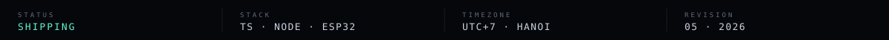
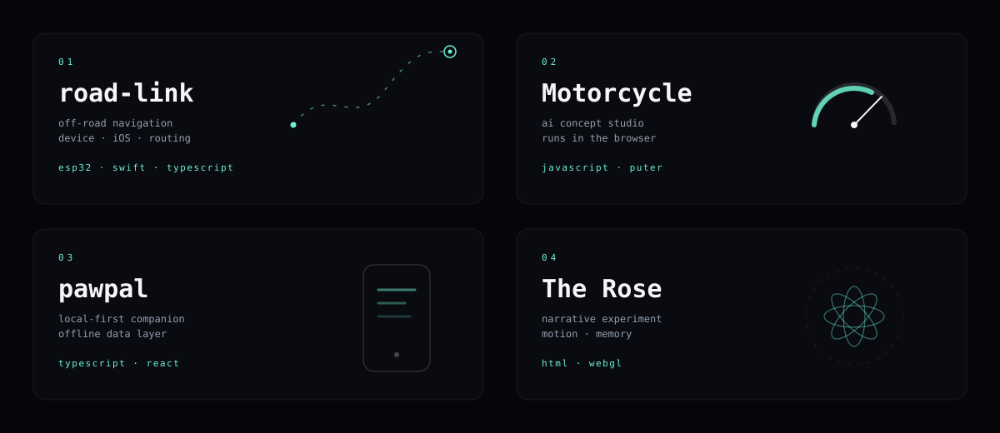

<div align="center">
  
</div>



<br>

```text
> build quietly. ship precisely.   ·   ít nói, làm tới cùng.
```

I build products end to end — firmware on a round ESP32 display, the app that talks to it, the pipeline behind both.

<br>

### // selected



- `01` **[road-link](https://github.com/al1103/road-link)** · `esp32` `swift` `typescript`
- `02` **[Motorcycle](https://al1103.github.io/Motorcycle/)** · `javascript` `puter`
- `03` **[pawpal](https://github.com/al1103/pawpal)** · `typescript` `react`
- `04` **[The-Rose-That-Remembers](https://al1103.github.io/The-Rose-That-Remembers/)** · `html` `webgl`

<br>

### // stack

```text
interface   react · next · tailwind · vanilla js
systems     node · python · php · sql
hardware    esp32 · c/c++ · sensors · displays
infra       cloudflare · github actions · docker
```

### // now

```text
learning    distributed systems · applied llm tooling
building    road-link v2 — routing · maps · on-device ui
open to     focused product work, hardware + software
```

### // signal

<a href="mailto:phamtuan72az@gmail.com"><code>email</code></a> &nbsp;·&nbsp;
<a href="https://github.com/al1103"><code>github</code></a> &nbsp;·&nbsp;
<a href="https://al1103.github.io/CV/"><code>cv</code></a>

<br>

<div align="center"><sub>nothing loud. everything deliberate.</sub></div>
