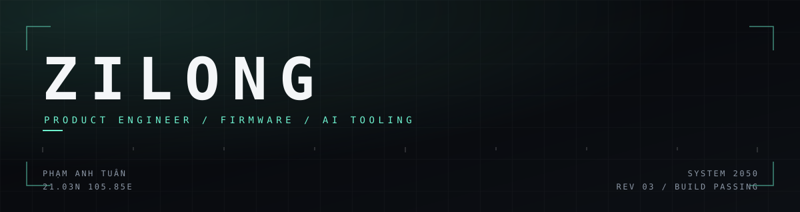

<div align="center">
  
</div>

<br>

**Build quietly. Ship precisely.** — Ít nói. Làm tới cùng.

I build products end to end: firmware on a round ESP32 display, the app that talks to it, the pipeline behind both. Clarity, speed, and code that still runs in ten years.

<br>

### Selected


`01`&nbsp; **[road-link](https://github.com/al1103/road-link)** &nbsp;`esp32` `swift` `typescript`
`02`&nbsp; **[Motorcycle](https://al1103.github.io/Motorcycle/)** &nbsp;`javascript` `puter`
`03`&nbsp; **[pawpal](https://github.com/al1103/pawpal)** &nbsp;`typescript` `react`
`04`&nbsp; **[The-Rose-That-Remembers](https://al1103.github.io/The-Rose-That-Remembers/)** &nbsp;`html` `webgl`

<br>

### Stack

```text
interface   react · next · tailwind · vanilla js
systems     node · python · php · sql
hardware    esp32 · c/c++ · sensors · displays
infra       cloudflare · github actions · docker
```

### Now

```text
learning    distributed systems · applied llm tooling
building    road-link v2 — routing · maps · on-device ui
open to     focused product work, hardware + software
```

### Signal

<a href="mailto:phamtuan72az@gmail.com"><code>email</code></a> &nbsp;·&nbsp;
<a href="https://github.com/al1103"><code>github</code></a> &nbsp;·&nbsp;
<a href="https://al1103.github.io/CV/"><code>cv</code></a>

<br>

<div align="center"><sub>nothing loud. everything deliberate.</sub></div>
