<div align="center">
  
</div>


<br>

```text
> build quietly. ship precisely.   ·   ít nói, làm tới cùng.
```

I build products end to end — firmware on a round ESP32 display, the app that talks to it, the pipeline behind both.

<br>

### // about

```yaml
currently  building road-link v2 — routing, maps, on-device ui
learning   distributed systems · applied llm tooling
open_to    focused product work, hardware + software
ask_me     esp32 · react · ai tooling · maps
```

<br>

### // selected


- `01` **[road-link](https://github.com/al1103/road-link)** · `esp32` `swift` `typescript`
- `02` **[Motorcycle](https://al1103.github.io/Motorcycle/)** · `javascript` `puter`
- `03` **[pawpal](https://github.com/al1103/pawpal)** · `typescript` `react`
- `04` **[The-Rose-That-Remembers](https://al1103.github.io/The-Rose-That-Remembers/)** · `html` `webgl`

<br>

### // stack

<p align="center">
  
  
  
  
  
  
  
  
  
  
  
  
</p>

<br>

### // stats

<p align="center">
  
  
</p>

<p align="center">
  
</p>

<br>

### // activity

<p align="center">
  
</p>

<br>

### // signal

<p align="center">
  <a href="mailto:phamtuan72az@gmail.com"></a>
  <a href="https://github.com/al1103"></a>
  <a href="https://al1103.github.io/CV/"></a>
  <a href="https://www.facebook.com/zilong1103"></a>
  <a href="https://www.instagram.com/yoo.han.965/"></a>
  
</p>

<br>

<div align="center"><sub>nothing loud. everything deliberate.</sub></div>
